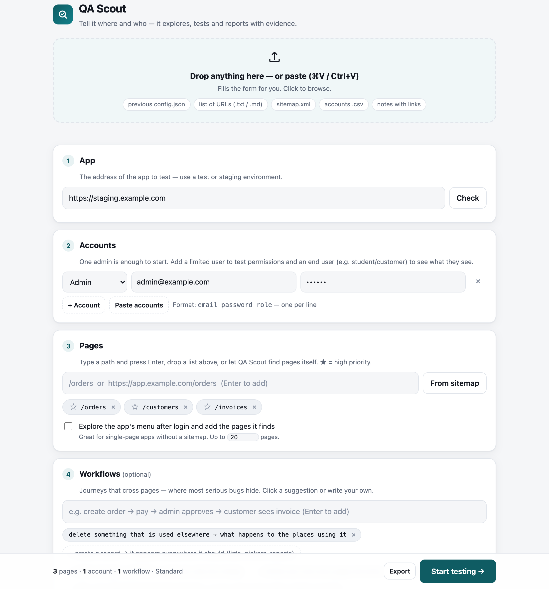

<p align="center">
  <a href="LICENSE"></a>
  <a href="CHANGELOG.md"></a>
  
  
  
</p>

# QA Scout

**A Claude Code skill that tests your web app the way an experienced QA engineer does — and shows its work.**

QA Scout opens a simple setup page, takes your app's address and a login, then drives a real, visible browser
(with a red cursor so you can follow every move), clicks every button, attacks forms, checks permissions, follows
data across pages, and hands you a report: per-page findings with highlighted screenshots, a video per page, a
workflows/interconnections report, and a filterable HTML dashboard.

Created by **[Rady Elkasas](https://radyelkasas.com/)** · MIT License


<details>
<summary>Setup page screenshot</summary>



</details>

⭐ **If QA Scout saves you a bug hunt, a star helps other developers find it.**

---

## Why

Most automated checks tell you a page *loads*. Real bugs live between pages: a record deleted on one screen that
silently breaks another, a total computed on a different scale, a button shown to users who can't use it, an error the
UI swallows. QA Scout is built around the habits of a seasoned tester:

- **Explore, then attack** — inventory every button, tab and row action; click them all.
- **Reproduce before reporting** — every finding has steps, expected vs actual, and evidence.
- **Verify at the source** — check the API/DB after writes, not just the screen.
- **Follow the data** — workflows across pages, delete-in-use, computed numbers, permissions.
- **Admit mistakes** — wrong claims are retracted and listed, never silently dropped.

## Features

| | |
|---|---|
| 🧭 **Two-minute setup** | Local setup page — drag & drop or paste a URL list, `sitemap.xml`, accounts CSV, notes, or a previous setup; one-click presets (Quick / Standard / Deep). |
| 🔎 **Page discovery** | No list? QA Scout logs in, expands the menus and collects the app's own pages. Or read them from your sitemap. |
| 🎥 **Watch it live** | Headed Chromium with a visible cursor, slowed down; one video per page. |
| 🧪 **Real testing** | Empty/invalid/boundary/contradictory input, CRUD with verification, delete-in-use, permissions with limited accounts, end-user view. |
| ♿ **Built-in page audit** | Hidden/clipped columns, unlabeled fields, mouse-only controls, nested controls, stacked dialogs, floating buttons covering content, untranslated text, raw i18n keys, low contrast, broken images (+ an Arabic spelling pack). |
| 🧾 **Evidence** | Screenshots with the problem element framed and labelled, network & console logs per page, request bodies of failures. |
| 📊 **Reports** | Markdown per page, interconnections & backend reports, and a self-contained HTML dashboard. Reports in English or Arabic. |
| 🌍 **Any project** | No framework assumptions. App specifics (language switch, content area, brand words, console noise) are config, not code. |

## Requirements

- [Claude Code](https://claude.com/claude-code)
- Node.js 18+
- A Chromium build — auto-detected from the Playwright cache or Google Chrome; otherwise
  `npx playwright@1.56.1 install chromium`, or set `QA_BROWSER=/path/to/chrome`.

## Install

```bash
git clone https://github.com/radyelkasas/qa-scout.git
cd qa-scout
./install.sh            # links into ~/.claude/skills/qa-scout (available in every project)
# ./install.sh --project /path/to/your/project   → only for one project (.claude/skills/qa-scout)
# ./install.sh --copy                            → copy instead of symlink
```

The installer runs `npm install` (only `playwright-core`) and checks for a browser.

## Use

In Claude Code, in your project:

```
run QA Scout on staging
```
or `/qa-scout`. Then:

1. **Setup page** opens at `http://127.0.0.1:4777` — enter the app URL, an admin login, and pages (or drop a list,
   or turn on menu discovery). Pick a preset. Press **Start testing**.
2. **Watch** the browser work through each page. Claude posts a short progress line per page.
3. **Read** the results in `qa-runs/<date>/`:

```
qa-runs/2026-10-14_1530/
├── report.html                 ← dashboard (filters, screenshots, workflows, audit)
├── report/
│   ├── 00-INDEX.md             ← summary, top findings, links
│   ├── 01-orders.md            ← steps, findings, what works, not tested, audit candidates
│   ├── INTERCONNECTIONS.md     ← workflow verdicts + cross-page findings
│   └── BACKEND.md              ← backend / data causes
├── videos/01-orders.webm       ← one per page
├── screenshots/01-orders/…     ← highlighted evidence
├── evidence/01-orders/{network,console}.jsonl
├── config.json  findings.jsonl  steps.jsonl  flows.jsonl  audit.jsonl
└── narrative/                  ← Claude's analysis, merged into the reports
```

Add `qa-runs/` to your `.gitignore` — runs may contain credentials and screenshots of your data.

## Setup page tips

- **Drop or paste anything**: a previous `config.json` or exported `qa-scout-setup.json` restores everything; text
  with links becomes pages; lines like `admin@example.com secret admin` become accounts; lines with `→` become workflows.
- **★** marks a page high priority. **Check** tells you if the app is reachable and whether it looks like a
  single-page app (then menu discovery is recommended).
- **Advanced options** hold everything else with sensible defaults: environment and data policy, API base URL
  (for data verification), repo paths (for root-cause analysis), read-only DB command, languages, viewport,
  video, slow-motion, rate limit.

## Configuration reference (`config.json`)

| Key | Meaning |
|---|---|
| `baseUrl`, `loginPath`, `apiBase` | Where the app, its login page and its API live. |
| `accounts[]` | `{label, role: admin\|limited\|enduser\|other, identifier, password, loginPath?}` |
| `pages[]` | `{id, url, priority, notes}` — ids are generated (`01-orders`). |
| `autoDiscover`, `maxPages` | Discover pages from the app's menu after login. |
| `workflows[]` | Cross-page journeys, e.g. `create order → pay → admin approves → customer sees invoice`. |
| `preset` / `depth`, `focus[]` | `smoke` · `standard` · `deep`; focus areas (functional, validation, interconnection, permissions, i18n, a11y, responsive, darkmode, console, data, security). |
| `environment`, `destructive` | `local\|staging\|production`; `qa-data-only\|allowed\|none`. |
| `languages`, `reportLanguage` | UI languages to test; report in `en` or `ar`. |
| `headed`, `video`, `slowMo`, `viewport`, `rateLimit` | Evidence and pacing. |
| `frontendRepo`, `backendRepo`, `dbCommand` | Optional — enables code mapping and data verification. |
| `localStorageInit` | Object written to localStorage before every page (e.g. force a UI language). |
| `contentSelector` | Main content area for inventory/audit (default: `main, [role=main], #main, #content, #app, #root`). |
| `allowLatinWords` | Words that are fine untranslated (brand names). |
| `ignoreConsole` | Regexes of console messages to ignore. |
| `driverPort` | Driver port (default 9333) — use different ports to run two at once. |

## How it works

```
 setup page (intake-server.js) ──► config.json
                                        │
 Claude Code ── step.sh ──HTTP──► driver.js (Playwright, headed, video per page)
      ▲                               │  H.login / startPage / click / type / pick / audit / finding / flow …
      │                               ▼
      └──────── reads results ◄── findings.jsonl · steps.jsonl · flows.jsonl · audit.jsonl · evidence/
                                        │
                                  report.js ──► report/*.md + report.html
```

The skill instructions (`SKILL.md`) tell Claude how to plan, which heuristics to apply
(`references/test-heuristics.md`), which pitfalls to avoid (`references/pitfalls.md`), and how to brief a
code-mapping agent (`references/recon-brief.md`).

## Safety

- Use a test or staging environment. With `destructive: qa-data-only` QA Scout only edits/deletes records it created
  (prefixed `QA`); with `none` (or `production`) it only observes.
- Everything runs locally; the setup page never sends data anywhere. Passwords are remembered only if you tick the box.
- QA Scout never modifies your application's code during a run.

## Contributing

Issues and pull requests are welcome — especially new audit rules, language packs, and pitfalls from real apps.
Keep the tool project-agnostic: app specifics belong in config.

## License & credits

MIT © 2026 [Rady Elkasas](https://radyelkasas.com/). Built with [Playwright](https://playwright.dev/) for
[Claude Code](https://claude.com/claude-code).
